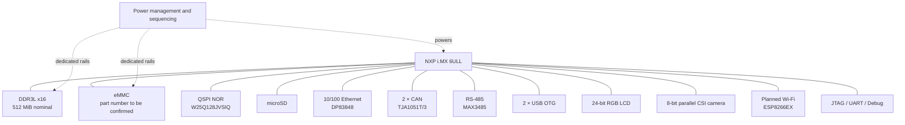

# BetaBake REV 1.0 — Industrial i.MX 6ULL SBC

**BetaBake** is a hardware design project for an embedded Single Board Computer (SBC) based on the **NXP i.MX 6ULL**. The goal is to integrate embedded computing, memory, storage, and several interfaces commonly required in industrial systems into a single board, including Ethernet, dual CAN, RS-485, USB, RGB LCD, CSI camera, and Wi-Fi.

> **Project status: Hardware schematic and PCB design using Altium Designer, supported by 2D documentation and 3D visualizations.** The board has not been physically manufactured. The Blender images presented here are visualization renders, not photographs of an assembled prototype or evidence of electrical functionality.

---

## Table of Contents

- [Visual Overview](#visual-overview)
- [Project Objectives and Features](#project-objectives-and-features)
- [System Architecture](#system-architecture)
- [Hardware Subsystems](#hardware-subsystems)
- [PCB Design](#pcb-design)
- [Repository Structure](#repository-structure)
- [Documentation and Deliverables](#documentation-and-deliverables)
- [Validation Status and Outstanding Checks](#validation-status-and-outstanding-checks)
- [Tools Used](#tools-used)
- [Scope and Limitations](#scope-and-limitations)

## Visual Overview

### 3D Visualization — Blender

The following renders represent the board designed in Altium Designer and subsequently visualized in Blender. They provide a view of both sides of the PCB without implying that a physical prototype has been assembled.

| Top Side | Bottom Side |
|---|---|
|  |  |
| `Images/3D/IMAGES BLENDER/1.png` | `Images/3D/IMAGES BLENDER/4.png` |

### PCB Layers — 2D Views

The PCB layer images are available in the `Images/2D/` directory.

<details>
<summary>View 2D PCB layers</summary>

#### Top Layer


#### Inner Layer 1


#### Inner Layer 2


#### Power Layer


#### Bottom Layer


</details>

> These 2D images show the exported PCB layer views included in the repository. Electrical connectivity, design rules, and manufacturing dimensions must be checked against the source PCB document and its design rules. A layer image alone is insufficient to perform these checks.

## Project Objectives and Features

BetaBake aims to provide an integrated hardware platform for embedded applications requiring multiple communication interfaces, display capabilities, and image acquisition.

| Function | Proposed Hardware Solution |
|---|---|
| Main processor | NXP i.MX 6ULL SoC, part number `MCIMX6Y2DVM08AB` |
| Working memory | Micron DDR3L `MT41K256M16TW-107:P`, x16 interface, nominal capacity of 512 MiB if the part number and organization are confirmed |
| On-board storage | eMMC, part number shown in the schematic as `S40FC004C1B1I00000` — to be confirmed against the bill of materials |
| Non-volatile serial memory | Winbond QSPI NOR `W25Q128JVSIQ` (128 Mbit, or 16 MiB) |
| Removable storage | microSD connector on the SD1 interface |
| Wired networking | 10/100 Ethernet using the TI `DP83848IVV/NOPB` PHY and a planned RJ45 connector with integrated magnetics |
| CAN bus | Two FlexCAN interfaces with two `TJA1051T/3` transceivers |
| Industrial serial bus | RS-485 using the `MAX3485EESA+T` transceiver |
| USB | Two USB OTG interfaces shown in the schematic |
| Display | 24-bit parallel RGB LCD interface |
| Camera | 8-bit parallel CSI camera interface exposing data, pixel clock, synchronization, and MCLK signals |
| Wireless connectivity | Wi-Fi interface planned around the ESP8266EX, primarily controlled through UART/GPIO |
| Debugging | JTAG and UART/debug signals exposed in the architecture |

The presence of an interface in the schematic describes the design intention. It does not mean that the interface has been tested on physical hardware.

## System Architecture

The central SoC connects the working memory to storage, communication, display, and image acquisition blocks. The logical architecture can be summarized as follows:



The hierarchical schematic separates the main functional blocks and uses named nets to connect signals across sheets. The supplied repository structure corresponds to a project revision containing, among other files, `01_Boot_Cfg.SchDoc` and a dedicated `10_CSI.SchDoc` sheet.

The schematic PDF recovered from September 21, 2026, used some different sheet names. Therefore, that PDF should be treated as a snapshot of the design rather than proof that every sheet name matches the current source project.

## Hardware Subsystems

### 1. SoC, Clocks, and Boot Configuration

The `MCIMX6Y2DVM08AB` is the central component. The documented signals include memory interfaces, `NVCC` I/O domains, reset signals, and power-management requests. The schematic shows a 32.768 kHz RTC crystal; the design discussions also mention a 24 MHz system clock reference.

Important considerations include I/O multiplexing configuration (IOMUX), the logic levels of each I/O bank, pin states during reset, boot straps, and power sequencing. The UART, CAN, LCD, CSI, Ethernet, and Wi-Fi functions must be checked against a single consolidated pin-mapping table to detect multiplexing conflicts.

### 2. DDR3L Memory

The planned memory device is the Micron `MT41K256M16TW-107:P`. The schematic exposes a 16-bit data bus, address signals, control signals, DQS strobes, and a differential clock. The nominal capacity associated with a 256M × 16 organization is 512 MiB, subject to confirmation against the complete part number and datasheet.

DDR3L is one of the most timing-sensitive parts of the design. Placement, relative trace lengths, impedance, return paths, terminations, the VREF network, and the ZQ pin must be checked against the NXP hardware design guide, Micron documentation, and the PCB manufacturer's capabilities.

Component values shown in the schematic should not be considered validated merely because they are present in the drawing.

### 3. eMMC, QSPI NOR, and microSD

**eMMC**

The schematic provides an 8-bit eMMC interface with `EMMC_DATA[7:0]`, `EMMC_CLK`, `EMMC_CMD`, and `EMMC_RST`. The part number transcribed from the available revision is `S40FC004C1B1I00000`.

Its exact commercial part number, capacity, operating mode, and power requirements must be confirmed against the datasheet and bill of materials before the BOM is finalized.

**QSPI NOR Flash**

The Winbond `W25Q128JVSIQ` is a 128-Mbit (16-MiB) serial NOR Flash memory. The exposed QSPI signals include `QSPI_A_SS0_B`, `QSPI_A_SCLK`, and `QSPI_A_DATA[3:0]`.

The use of this memory for boot code, firmware, or other data will depend on the final boot configuration and software architecture.

**microSD**

A microSD connector is shown on the SD1 interface, with `CLK`, `CMD`, `DATA0–DATA3`, and mechanical card detection.

The presence of the connector does not prove that the microSD card is selected as the default boot source.

### 4. 10/100 Ethernet

The identified PHY is the TI `DP83848IVV/NOPB`, connected to the SoC through RMII according to the schematic. The Ethernet sheet shows a 50 MHz external clock, the `MDC/MDIO` management signals, analog and bias networks, protection components, and a planned RJ45 connector with integrated magnetics (`WE-RJ45-7498010210A`).

The exact connector part number and pinout must be checked against the manufacturer's documentation.

The main verification points are the RMII clock source and direction, PHY address/configuration straps, reset, bias resistors, ground-reference strategy, and chassis connection.

The Ethernet differential pairs should be short, appropriately length-matched, routed with minimal vias, and free of unnecessary stubs. ESD protection should be positioned close to the external connector.

### 5. Dual CAN

The SoC's two FlexCAN controllers are connected to two `TJA1051T/3` transceivers. Each channel has a dedicated connector shown in the schematic, together with protection and filtering/termination circuitry.

The exact topology of the resistors connected around CANH/CANL must be checked in the source schematic. Bus termination must reflect the physical network topology; it should not be enabled indiscriminately on every node.

The logic levels, TJA1051T/3 VIO connection, transient protection, and ground connections must also be verified.

### 6. RS-485

The RS-485 interface uses the `MAX3485EESA+T` transceiver, controlled through `RS-485_TX`, `RS-485_RX`, and `RS-485_MODE`.

A 120 Ω termination resistor and a bias network are shown in the schematic. The intended operating principle is to keep the interface in receive mode by default during reset.

The following points remain to be checked:

- Defined startup states for DE and `/RE`.
- Fail-safe bias resistor calculations.
- Termination placement at the physical ends of the bus.
- Compatibility of the transient protection with the application.
- Whether galvanic isolation is required for the intended industrial environment.

Galvanic isolation cannot be assumed from the presence of the transceiver alone.

### 7. USB

Two USB OTG ports are planned. The corresponding schematic sheet includes connectors, ESD protection, and VBUS protection components.

The host/device role of each port, VBUS management, current limiting, overcurrent detection, and connector shield connections must be defined and verified.

The D+/D− pairs require routing that complies with USB 2.0 constraints and the actual PCB stack-up.

### 8. RGB LCD and Touchscreen

The SoC interface includes `LCD_DATA[23:0]`, `LCD_CLK`, `LCD_HSYNC`, `LCD_VSYNC`, and `LCD_ENABLE`, along with reset and display-enable control signals.

The design discussions identified a 5-inch CDTech IPS RGB display with capacitive touch as a candidate. The exact module part number remains to be finalized.

Before the design is frozen, the following must be confirmed:

- Display pinout and I/O voltage levels.
- Video timings, including pixel clock, porches, and synchronization polarities.
- Correct mapping of the 24 color-data bits.
- Backlight power supply and control.
- Touch controller interface.
- Mechanical compatibility with the PCB and enclosure.

### 9. CSI Camera

The SoC exposes an 8-bit parallel CSI interface with `CSI_DATA[7:0]`, `CSI_MCLK`, `CSI_HSYNC`, `CSI_VSYNC`, and `CSI_PIXCLK`, along with reset and power-down control signals.

Earlier design discussions mentioned an `MT9M114` sensor and a 24-pin FPC connector. These must be confirmed in `10_CSI.SchDoc` and against the documentation for the selected sensor.

This parallel interface must not be confused with MIPI CSI-2. The sensor power rails, configuration interface, reset/power-down sequences, FPC pinout, data-bit ordering, and synchronization timings all require verification.

### 10. Wi-Fi

The planned Wi-Fi integration is based on the ESP8266EX. The signal names identified in the design include `WF_U0RXD`, `WF_U0TXD`, and `WF_EXT_RSTB`, along with other signals exposed in the CPU schematic. UART is the communication mechanism discussed for integration.

The complete RF section, exact module part number, antenna, matching network, and keep-out requirements are not confirmed by the supplied file listing alone.

The following must also be checked:

- 3.3 V supply stability and peak current capability.
- Local decoupling.
- Boot strap levels.
- Reset polarity and sequencing.
- UART routing.
- Antenna placement and copper/ground-plane keep-out requirements.

### 11. Power Management and Sequencing

The design notes mention several power domains: +12 V, +5 V, 3.3 V, and 1.8 V, along with domains associated with the SoC and DDR memory.

Similar names, such as `VDD_3V3` and `VCC_3V3`, must not be connected without confirming that they represent the same electrical domain.

Every rail should be documented with its source, nominal voltage, tolerances, current capability, connected loads, startup sequence, and measurement points.

SoC sequencing, DDR3L requirements, eMMC VCC/VCCQ rails, and reset states must be reviewed using the relevant datasheets.

Decoupling capacitors must be assessed based on their physical placement, current loops, electrical characteristics, and the manufacturer's recommendations.

## PCB Design

The discussed target is an **8-layer PCB**, with three dedicated ground layers and one power layer.

The working stack-up proposal is:

| Layer | Intended Role |
|---|---|
| L1 | Signals, components, and local fanout |
| L2 | Continuous GND plane |
| L3 | Internal signals, including memory routing where appropriate |
| L4 | Power distribution regions |
| L5 | Continuous GND plane |
| L6 | Internal signals, including eMMC/SD where appropriate |
| L7 | Continuous GND plane |
| L8 | Secondary signals and possible fanout |

This stack-up is a **design proposal**, not a confirmed manufacturing specification. It must be adapted to the actual stack-up provided by the PCB manufacturer, with suitable trace widths and spacings calculated for the required impedance targets.

Key layout principles include:

- Preserve continuous return planes under high-speed signals.
- Avoid routing differential pairs over gaps or splits in reference planes.
- Control impedance and trace lengths for applicable interfaces.
- Define net classes, clearance rules, annular rings, and drill sizes that comply with manufacturing capabilities.
- Place decoupling capacitors close to power pins and minimize current-loop areas.
- Verify the SoC BGA fanout and memory vias against the manufacturer's actual fabrication limits.
- Recalculate copper pours after routing changes.

The layer images in `Images/2D/` are documentation views. The source PCB document, `PCB/BetaBake_REV_1.0.PcbDoc`, is required to inspect detailed routing and design rules.

## Repository Structure

```text
BETABAKE_REV1.0/
├── .gitattributes
├── Adobe_reader_3D_BetaBake_REV_1.0.pdf
├── BetaBake_REV_1.0.pdf
├── BetaBake_REV_1.0_DRAFTSMAN.pdf
├── Images/
│   ├── 2D/
│   │   ├── BOTTOM_LAYER.png
│   │   ├── INNER_LAYER1.png
│   │   ├── INNER_LAYER_2.png
│   │   ├── PWR_LAYER.png
│   │   └── TOP_LAYER.png
│   └── 3D/
│       ├── IMAGES ALTIUM/
│       │   ├── BetaBake_REV_1.0.png
│       │   └── BetaBake_REV_1.01.png
│       └── IMAGES BLENDER/
│           ├── 1.png  # Blender render of the top side
│           └── 4.png  # Blender render of the bottom side
├── PCB/
│   ├── BetaBake_REV_1.0.PcbDoc
│   ├── Copy before routing of BetaBake..PcbDoc
│   └── README.txt
└── SCHEMATICS/
    ├── 01_Boot_Cfg.SchDoc
    ├── 02_DDR3L.SchDoc
    ├── 03_Boot_Memory.SchDoc
    ├── 04_Ethernet.SchDoc
    ├── 05_USB.SchDoc
    ├── 06_CAN_RS485.SchDoc
    ├── 07_Display_LCD.SchDoc
    ├── 08_Debug.SchDoc
    ├── 09_Power.SchDoc
    └── 10_CSI.SchDoc
```

### Main Files and Their Purpose

- `BetaBake_REV_1.0.pdf`: exported project PDF for reviewing and sharing the design documentation.
- `BetaBake_REV_1.0_DRAFTSMAN.pdf`: drawing/documentation-oriented PDF. Its exact contents should be checked before using it as a manufacturing document.
- `Adobe_reader_3D_BetaBake_REV_1.0.pdf`: 3D PDF intended for viewing with a compatible reader.
- `PCB/BetaBake_REV_1.0.PcbDoc`: main Altium PCB source document for this revision.
- `PCB/Copy before routing of BetaBake..PcbDoc`: an earlier pre-routing working copy retained for reference; it is not necessarily the current design.
- `SCHEMATICS/*.SchDoc`: schematic sheets organized by subsystem.
- `Images/2D/`: exported PCB layer views.
- `Images/3D/IMAGES ALTIUM/`: 3D renders exported from Altium.
- `Images/3D/IMAGES BLENDER/`: Blender renders showing the top and bottom sides.

## Documentation and Deliverables

The repository contains the documents listed in the directory structure. It provides access to schematic and PCB exports, Altium source files, and 2D/3D visualizations.

Before describing the repository as a **complete manufacturing package**, verify the availability and consistency of the following:

- Gerber or ODB++ manufacturing files.
- NC Drill files.
- A BOM containing exact manufacturer part numbers.
- Pick-and-place files.
- Assembly notes.
- Mechanical drawings.
- The final PCB stack-up and manufacturing specifications.

The presence of PDFs and the `.PcbDoc` file does not by itself guarantee that all manufacturing deliverables are included or ready for production.

## Validation Status and Outstanding Checks

The project is documented at the system architecture and CAD design level. Since the board has not been manufactured, no physical bring-up, laboratory validation, or electrical measurements on a prototype can be claimed.

The main checks required before manufacturing are:

1. **Power management and sequencing — high priority:** Verify rail voltages, tolerances, current capability, power-up/power-down sequencing, brown-out behavior, and reset states.
2. **DDR3L — high priority:** Verify topology, timing constraints, trace lengths, impedance, VREF, ZQ, and termination networks.
3. **eMMC — high priority:** Confirm the exact part number, capacity, operating mode, VCC/VCCQ requirements, reset, and package compatibility.
4. **IOMUX and boot configuration:** Ensure that all interfaces have the required pins without conflicts, including CAN, Wi-Fi UART, LCD, CSI, Ethernet, microSD, JTAG, and boot signals.
5. **RMII Ethernet:** Confirm the 50 MHz clock, PHY straps, reset, analog network, and chassis connection.
6. **CAN/RS-485:** Verify termination, bias networks, line protection, reset states, and any need for isolation.
7. **LCD/CSI/Wi-Fi:** Finalize part numbers, connectors, sequencing, logic levels, timings, RF implementation, and power requirements.
8. **PCB:** Run DRC, verify manufacturer constraints, controlled impedance, return paths, ground planes, drill limits, and BGA fanout.
9. **Manufacturing documentation:** Validate the final file package and schematic/PCB revision consistency before sending the design to a manufacturer.
10. **Hardware bring-up:** After manufacturing and assembly, test the power rails, clocks, resets, JTAG/UART, boot sequence, DDR, storage, and each interface step by step.

## Tools Used

- **Altium Designer** — hierarchical schematic design, multilayer PCB layout, design documentation, and 3D PCB views.
- **Blender** — 3D visualization of the PCB to present its top and bottom sides.
- **PDF and image exports** — sharing schematics, drawings, and PCB layer views.

## Scope and Limitations

This README consolidates the supplied repository structure and the information available in the technical report associated with the schematic revision dated **September 21, 2026**.

Some later design decisions — particularly the schematic sheet organization, final display and camera references, exact eMMC part number, and Wi-Fi integration — must be checked against the source files currently present in the repository.

**BetaBake is presented as a hardware and PCB design project, not as a tested industrial product.** The Blender renders are visual representations of the CAD design. Electrical validation, manufacturability, and real-world operation remain to be established through formal design review, manufacturing, and testing.
