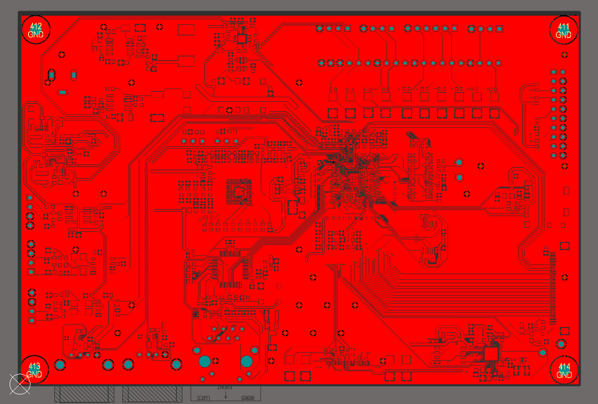
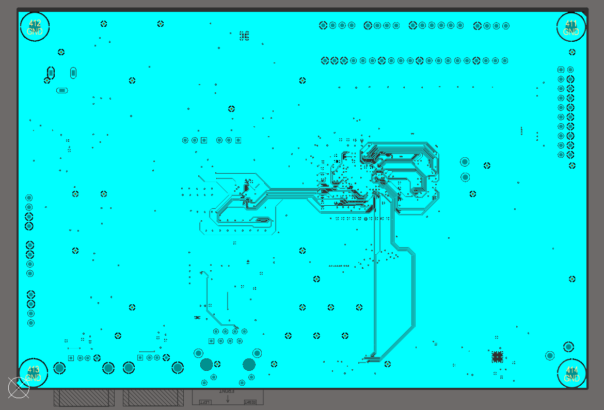
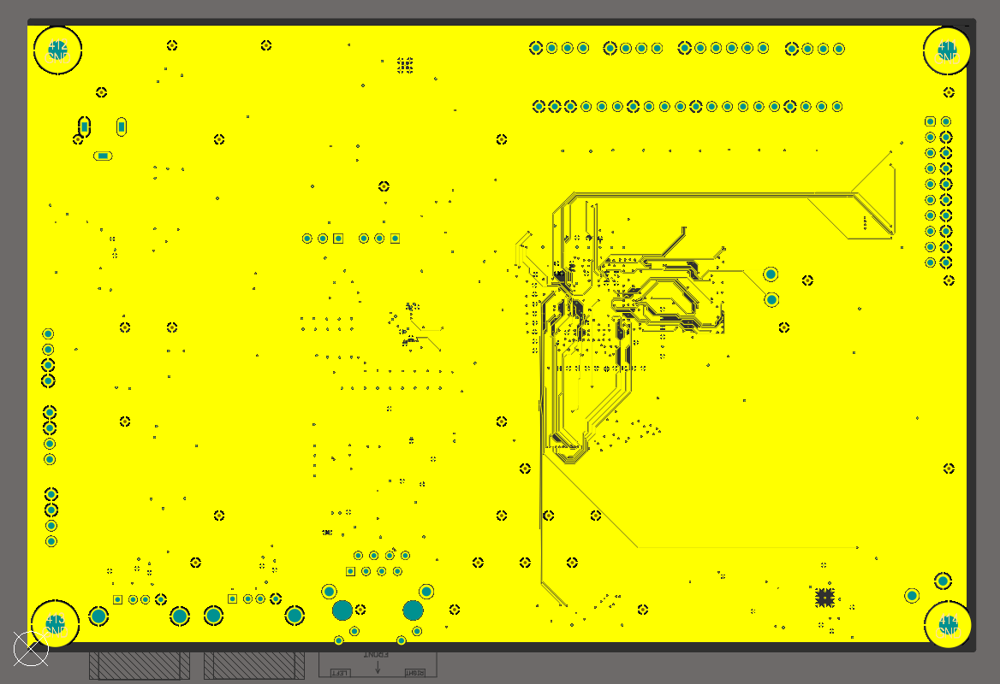
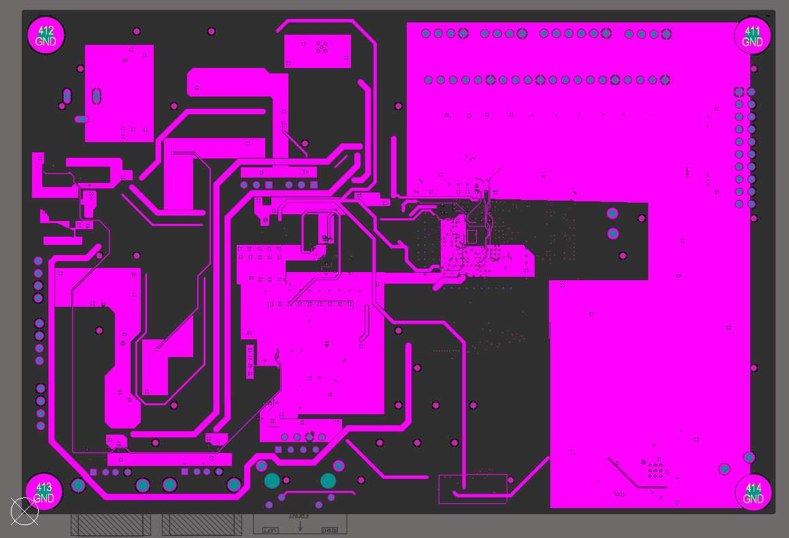
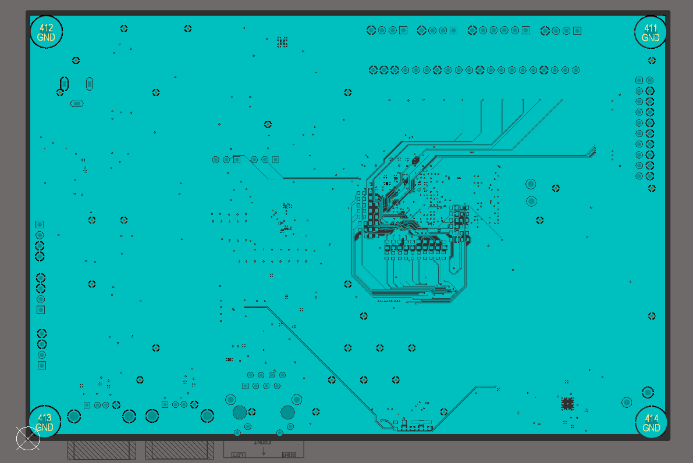
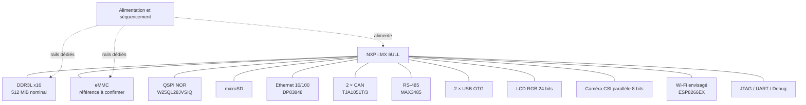

# BetaBake REV 1.0 — Industrial i.MX 6ULL SBC

**BetaBake** est un projet de conception hardware d'une carte informatique embarquée (*Single Board Computer*, SBC) basée sur le **NXP i.MX 6ULL**. L'objectif est de réunir sur une même carte le calcul embarqué, la mémoire, le stockage et plusieurs interfaces utiles à l'intégration dans un système industriel : Ethernet, deux canaux CAN, RS-485, USB, LCD RGB, caméra CSI et Wi-Fi.

> **État du projet : conception schématique et PCB sous Altium Designer, avec documentation 2D et visualisations 3D.** La carte n'ayant pas été fabriquée physiquement, les images Blender présentées ici sont des rendus de visualisation — elles ne constituent pas des photographies d'un prototype assemblé ni une preuve de fonctionnement électrique.

---

## Sommaire

- [Aperçu visuel](#aperçu-visuel)
- [Objectifs et fonctionnalités](#objectifs-et-fonctionnalités)
- [Architecture générale](#architecture-générale)
- [Sous-systèmes hardware](#sous-systèmes-hardware)
- [Conception du PCB](#conception-du-pcb)
- [Organisation du dépôt](#organisation-du-dépôt)
- [Documents et livrables](#documents-et-livrables)
- [État de validation et points à vérifier](#état-de-validation-et-points-à-vérifier)
- [Outils utilisés](#outils-utilisés)
- [Périmètre et limites](#périmètre-et-limites)

## Aperçu visuel

### Visualisation 3D — Blender

Les rendus suivants représentent la carte conçue dans Altium Designer puis visualisée sous Blender. Ils permettent d'examiner l'apparence générale des deux faces sans laisser entendre qu'un exemplaire physique a été assemblé.

| Face supérieure | Face inférieure |
|---|---|
|  |  |
| `Images/3D/IMAGES BLENDER/1.png` | `Images/3D/IMAGES BLENDER/4.png` |

### Couches du PCB — vues 2D

Les images des couches sont disponibles directement dans `Images/2D/`.

<details>
<summary>Afficher les couches 2D</summary>

#### Top Layer



#### Inner Layer 1



#### Inner Layer 2



#### Power Layer



#### Bottom Layer



</details>

> Les captures 2D montrent les vues exportées dans le dépôt. Pour contrôler les connexions, les règles électriques ou les dimensions de fabrication, il faut se reporter au document PCB source et à ses règles de conception ; une image de couche ne suffit pas à effectuer cette vérification.

## Objectifs et fonctionnalités

BetaBake vise à fournir une plateforme matérielle intégrée pour des applications embarquées nécessitant plusieurs interfaces de communication et des possibilités d'affichage et de capture d'image.

| Fonction | Solution prévue dans la conception |
|---|---|
| Calcul principal | SoC NXP i.MX 6ULL, référence `MCIMX6Y2DVM08AB` |
| Mémoire de travail | DDR3L Micron `MT41K256M16TW-107:P`, bus x16, capacité nominale de 512 MiB si la référence et l'organisation sont confirmées |
| Stockage embarqué | eMMC, référence indiquée dans le schéma `S40FC004C1B1I00000` — à confirmer dans la nomenclature |
| Mémoire non volatile série | QSPI NOR Winbond `W25Q128JVSIQ` (128 Mbit, soit 16 MiB) |
| Stockage amovible | Connecteur microSD sur l'interface SD1 |
| Réseau filaire | Ethernet 10/100 avec PHY TI `DP83848IVV/NOPB` et connecteur RJ45 avec magnétics intégrés prévu |
| Bus CAN | Deux interfaces FlexCAN avec deux transceivers `TJA1051T/3` |
| Bus série industriel | RS-485 avec transceiver `MAX3485EESA+T` |
| USB | Deux interfaces USB OTG prévues dans le schéma |
| Affichage | Interface LCD parallèle RGB 24 bits |
| Caméra | Interface caméra parallèle CSI 8 bits exposant données, horloge pixel, synchronisations et MCLK |
| Connectivité sans fil | Interface Wi-Fi envisagée autour de l'ESP8266EX, pilotée notamment par UART/GPIO |
| Mise au point | Signaux JTAG et UART/debug exposés dans l'architecture |

La présence d'une interface dans le schéma décrit l'intention de conception. Elle ne signifie pas qu'elle a été testée sur du matériel réel.

## Architecture générale

Le SoC central relie la mémoire de travail aux blocs de stockage, de communication, d'affichage et de capture. La structure logique peut être résumée ainsi :



Le schéma hiérarchique permet de séparer les grands ensembles fonctionnels et de réutiliser des noms de nets entre les feuilles. La structure du dépôt fournie correspond à la révision de projet comprenant notamment `01_Boot_Cfg.SchDoc` et une feuille dédiée `10_CSI.SchDoc`. La révision PDF datée du 21 septembre 2026 retrouvée précédemment utilisait certains noms de feuilles différents : il faut donc traiter le PDF comme un instantané de la conception, et non comme la preuve que tous les noms de feuilles sont identiques à ceux du projet source actuel.

## Sous-systèmes hardware

### 1. SoC, horloges et démarrage

Le `MCIMX6Y2DVM08AB` est le composant central. Les signaux documentés comprennent notamment les interfaces mémoire, les banques d'E/S `NVCC`, les signaux de reset et les demandes de gestion d'alimentation. Le schéma fait apparaître un quartz RTC de 32,768 kHz ; les échanges de conception évoquent également une référence système de 24 MHz.

Les points importants sont la configuration des broches multiplexées (IOMUX), les niveaux logiques de chaque banque, les états des broches au reset, les straps de démarrage et la séquence des alimentations. Les fonctions UART, CAN, LCD, CSI, Ethernet et Wi-Fi doivent être recoupées dans une table de pin mapping unique afin de détecter les conflits de multiplexage.

### 2. DDR3L

La mémoire prévue est la Micron `MT41K256M16TW-107:P`. Le schéma expose un bus de données 16 bits, les adresses, les signaux de commande, les strobes DQS et une horloge différentielle. La capacité nominale associée à l'organisation 256M × 16 est de 512 MiB, à confirmer à partir de la référence complète et de sa fiche technique.

La DDR3L est l'une des parties les plus sensibles du design. Le placement, les longueurs relatives, l'impédance, les retours de courant, les terminaisons, le réseau VREF et la broche ZQ doivent être contrôlés conformément au guide hardware NXP, à la documentation Micron et aux contraintes du fabricant de PCB. Les valeurs de composants présentes dans le schéma ne doivent pas être considérées comme validées uniquement parce qu'elles figurent sur le dessin.

### 3. eMMC, QSPI NOR et microSD

**eMMC.** Le schéma prévoit une interface 8 bits avec `EMMC_DATA[7:0]`, `EMMC_CLK`, `EMMC_CMD` et `EMMC_RST`. La référence transcrite dans la révision disponible est `S40FC004C1B1I00000`. Sa référence commerciale exacte, sa capacité, son mode de fonctionnement et ses exigences d'alimentation doivent être confirmés dans la fiche technique et la nomenclature avant le gel du BOM.

**QSPI NOR.** La mémoire `W25Q128JVSIQ` de Winbond est une NOR série de 128 Mbit (16 MiB). Les signaux QSPI exposés comprennent `QSPI_A_SS0_B`, `QSPI_A_SCLK` et `QSPI_A_DATA[3:0]`. L'usage de cette mémoire pour le démarrage, le firmware ou les données dépendra de la configuration boot et du logiciel effectivement retenus.

**microSD.** Un connecteur microSD est dessiné sur l'interface SD1, avec `CLK`, `CMD`, `DATA0–DATA3` et détection mécanique. La présence du connecteur ne prouve pas que la carte microSD est la source de démarrage sélectionnée par défaut.

### 4. Ethernet 10/100

Le PHY identifié est le TI `DP83848IVV/NOPB`, connecté au SoC en RMII dans le schéma. La feuille Ethernet montre une horloge externe de 50 MHz, les signaux de gestion `MDC/MDIO`, des réseaux analogiques et de polarisation, des protections et un connecteur RJ45 avec magnétics intégrés prévu (`WE-RJ45-7498010210A`). La référence et le brochage exacts du connecteur doivent être vérifiés avec sa documentation fabricant.

Les points de contrôle principaux sont le sens et la source de l'horloge RMII, les straps d'adresse/configuration du PHY, le reset, les résistances de biais, la séparation des références de masse et la stratégie de connexion au châssis. Les paires Ethernet doivent être courtes, correctement appariées, avec peu de vias et sans dérivations inutiles. La protection ESD doit être proche de l'entrée externe.

### 5. Double CAN

Les deux contrôleurs FlexCAN du SoC sont associés à deux transceivers `TJA1051T/3`. Chaque canal dispose d'un connecteur dédié dans le schéma, ainsi que d'une protection et d'un réseau de filtrage/terminaison.

La topologie exacte des résistances dessinées autour de CANH/CANL doit être vérifiée dans le schéma source. La terminaison de bus doit correspondre à l'architecture physique du réseau — elle ne doit pas être activée arbitrairement sur chaque nœud. Les niveaux logiques, la broche VIO, la protection contre les transitoires et la connexion de masse doivent également être confirmés.

### 6. RS-485

L'interface RS-485 utilise le `MAX3485EESA+T`, piloté par `RS-485_TX`, `RS-485_RX` et `RS-485_MODE`. Une résistance de terminaison de 120 Ω et un réseau de polarisation sont indiqués dans la feuille. Le principe retenu est de placer l'interface en réception par défaut au reset.

Il reste à vérifier les états imposés sur DE et `/RE` au démarrage, le calcul de la polarisation failsafe, la terminaison aux extrémités du bus et la compatibilité de la protection transitoire avec l'application. L'isolation galvanique n'est pas démontrée par la seule présence du transceiver et doit être étudiée en fonction de l'environnement industriel visé.

### 7. USB

Deux ports USB OTG sont prévus. La feuille comporte des connecteurs, des protections ESD et des éléments de protection sur VBUS. Le rôle host/device, la gestion de VBUS, la limitation de courant, la détection de surintensité et le raccordement des blindages doivent être définis et vérifiés. Les paires D+/D− nécessitent un routage correspondant aux contraintes USB 2.0 et au stack-up réel.

### 8. LCD RGB et tactile

L'interface du SoC comprend `LCD_DATA[23:0]`, `LCD_CLK`, `LCD_HSYNC`, `LCD_VSYNC` et `LCD_ENABLE`, ainsi que des commandes de reset et d'activation. Les échanges de conception ont retenu comme piste un écran CDTech IPS RGB de 5 pouces avec tactile capacitif ; la référence exacte du module reste à figer.

Avant finalisation, il faut confirmer le brochage du panneau, les tensions d'E/S, les timings vidéo (fréquence pixel, porches et polarités), le mapping des 24 bits couleur, l'alimentation du rétroéclairage et l'interface du tactile. La compatibilité mécanique doit aussi être vérifiée à partir du dessin du module et du PCB.

### 9. Caméra CSI

Le SoC expose une interface CSI parallèle avec `CSI_DATA[7:0]`, `CSI_MCLK`, `CSI_HSYNC`, `CSI_VSYNC` et `CSI_PIXCLK`, ainsi que des signaux de reset et de mise hors tension. Les échanges précédents évoquaient un capteur `MT9M114` et un connecteur FPC 24 broches ; ces éléments doivent être confirmés dans la feuille `10_CSI.SchDoc` et la documentation du capteur retenu.

Cette interface parallèle ne doit pas être confondue avec MIPI CSI-2. Il faut vérifier les tensions, la configuration du capteur, les séquences reset/power-down, le brochage FPC, l'ordre des bits et les timings de synchronisation.

### 10. Wi-Fi

L'intégration Wi-Fi envisagée est basée sur l'ESP8266EX. Les noms de signaux relevés comprennent `WF_U0RXD`, `WF_U0TXD` et `WF_EXT_RSTB`, avec d'autres signaux exposés dans le schéma CPU. La liaison UART est le mécanisme de communication retenu dans les échanges de conception.

La section RF complète, la référence exacte du module, l'antenne, l'éventuel réseau d'adaptation et les règles de keep-out ne sont pas confirmés par la seule liste de fichiers fournie. Il faut également vérifier les pointes de courant, le découplage, la stabilité du rail 3,3 V, les straps de boot et la logique de reset avant toute validation.

### 11. Alimentation et séquencement

Les notes de conception évoquent plusieurs domaines : +12 V, +5 V, 3,3 V, 1,8 V ainsi que des domaines associés au SoC et à la DDR. Les noms proches tels que `VDD_3V3` et `VCC_3V3` ne doivent pas être reliés sans confirmer qu'ils représentent bien le même domaine électrique.

Chaque rail doit être documenté avec sa source, sa tension nominale, ses tolérances, sa capacité en courant, ses charges, son ordre de démarrage et ses moyens de mesure. Le séquencement du SoC, la DDR3L, les rails VCC/VCCQ de l'eMMC et l'état de reset doivent être revus à l'aide des fiches techniques. Les capacités de découplage doivent être validées en tenant compte de leur emplacement physique, de leur boucle de courant et des recommandations constructeur.

## Conception du PCB

La cible de routage discutée pour BetaBake est un PCB multicouche de **8 couches**, avec trois couches de masse dédiées et une couche d'alimentation. L'empilage de travail évoqué est :

| Couche | Rôle envisagé |
|---|---|
| L1 | Signaux, composants et fanout local |
| L2 | Plan GND continu |
| L3 | Signaux internes, notamment mémoire selon le routage final |
| L4 | Régions d'alimentation |
| L5 | Plan GND continu |
| L6 | Signaux internes, dont eMMC/SD selon l'affectation finale |
| L7 | Plan GND continu |
| L8 | Signaux secondaires et éventuel fanout |

Cet empilage est une **proposition de conception**, et non une spécification de fabrication confirmée. Il faut l'adapter au stack-up réel du fabricant et calculer les largeurs/espacements nécessaires aux impédances contrôlées.

Principes à respecter :

- préserver des plans de retour continus sous les signaux rapides ;
- ne pas faire traverser une paire différentielle au-dessus d'une fente de plan ;
- contrôler l'impédance et les longueurs des interfaces concernées ;
- définir les classes de nets, les règles de clearance, les annular rings et les limites de perçage compatibles avec le fabricant ;
- garder le découplage près des broches d'alimentation et minimiser les boucles de courant ;
- vérifier le fanout BGA du SoC et les vias de mémoire par rapport aux capacités de fabrication réelles ;
- recalculer les zones de cuivre après toute modification du routage.

Les images de couches contenues dans `Images/2D/` sont des vues de documentation ; le PCB source (`PCB/BetaBake_REV_1.0.PcbDoc`) reste nécessaire pour vérifier le détail du routage et les règles DRC.

## Organisation du dépôt

```text
BETABAKE_REV1.0/
├── .gitattributes
├── Adobe_reader_3D_BetaBake_REV_1.0.pdf
├── BetaBake_REV_1.0.pdf
├── BetaBake_REV_1.0_DRAFTSMAN.pdf
├── Images/
│   ├── 2D/
│   │   ├── BOTTOM_LAYER.png
│   │   ├── INNER_LAYER1.png
│   │   ├── INNER_LAYER_2.png
│   │   ├── PWR_LAYER.png
│   │   └── TOP_LAYER.png
│   └── 3D/
│       ├── IMAGES ALTIUM/
│       │   ├── BetaBake_REV_1.0.png
│       │   └── BetaBake_REV_1.01.png
│       └── IMAGES BLENDER/
│           ├── 1.png  # Rendu Blender de la face supérieure
│           └── 4.png  # Rendu Blender de la face inférieure
├── PCB/
│   ├── BetaBake_REV_1.0.PcbDoc
│   ├── Copy before routing of BetaBake..PcbDoc
│   └── README.txt
└── SCHEMATICS/
    ├── 01_Boot_Cfg.SchDoc
    ├── 02_DDR3L.SchDoc
    ├── 03_Boot_Memory.SchDoc
    ├── 04_Ethernet.SchDoc
    ├── 05_USB.SchDoc
    ├── 06_CAN_RS485.SchDoc
    ├── 07_Display_LCD.SchDoc
    ├── 08_Debug.SchDoc
    ├── 09_Power.SchDoc
    └── 10_CSI.SchDoc
```

### À quoi servent les principaux fichiers ?

- `BetaBake_REV_1.0.pdf` : document PDF du projet électronique, utile pour consulter et partager la documentation exportée.
- `BetaBake_REV_1.0_DRAFTSMAN.pdf` : version de dessin/documentation destinée à une lecture plus orientée plans ; vérifier son contenu exact avant de l'utiliser comme document de fabrication.
- `Adobe_reader_3D_BetaBake_REV_1.0.pdf` : PDF 3D destiné à la consultation avec un lecteur compatible.
- `PCB/BetaBake_REV_1.0.PcbDoc` : document PCB Altium source de la révision principale.
- `PCB/Copy before routing of BetaBake..PcbDoc` : copie de travail antérieure au routage, conservée pour référence ; ce n'est pas nécessairement la version actuelle.
- `SCHEMATICS/*.SchDoc` : feuilles schématiques par sous-système.
- `Images/2D/` : exports visuels des couches de PCB.
- `Images/3D/IMAGES ALTIUM/` : rendus 3D exportés depuis Altium.
- `Images/3D/IMAGES BLENDER/` : rendus Blender des faces supérieure et inférieure.

## Documents et livrables

Le dépôt comprend les documents listés dans l'arborescence. Il permet de consulter le schéma et le PCB à travers les exports et les fichiers sources Altium, ainsi que des visualisations 2D/3D.

Avant de qualifier les fichiers comme un **package de fabrication complet**, vérifier au minimum la présence et la cohérence des Gerber ou ODB++, des fichiers NC Drill, du BOM avec références fabricant exactes, des fichiers pick-and-place, des notes d'assemblage, du dessin mécanique et du stack-up fourni par le fabricant. La présence des PDF et du fichier `.PcbDoc` ne garantit pas à elle seule que tous ces livrables sont inclus ou prêts à être envoyés en production.

## État de validation et points à vérifier

Le projet est documenté au niveau de l'architecture et du design assisté par ordinateur. La carte n'ayant pas été fabriquée, il n'est pas possible de revendiquer un bring-up, une validation en laboratoire ou des mesures électriques sur un prototype.

Les principaux contrôles à mener avant fabrication sont :

1. **Alimentation et séquencement (priorité haute)** : rails, tolérances, courants, power-up/power-down, brown-out et états reset.
2. **DDR3L (priorité haute)** : topologie, contraintes temporelles, longueurs, impédances, VREF, ZQ et terminaisons.
3. **eMMC (priorité haute)** : référence exacte, capacité, mode, VCC/VCCQ, reset et compatibilité du boîtier.
4. **IOMUX et boot** : vérifier que toutes les interfaces disposent des broches nécessaires sans conflit, notamment CAN, UART Wi-Fi, LCD, CSI, Ethernet, microSD, JTAG et signaux de boot.
5. **Ethernet RMII** : horloge 50 MHz, straps du PHY, reset, réseau analogique et raccordement au châssis.
6. **CAN/RS-485** : terminaisons, polarisation, protection de ligne, états au reset et besoin éventuel d'isolation.
7. **LCD/CSI/Wi-Fi** : références finales, connecteurs, séquences, niveaux logiques, timings, RF et alimentation.
8. **PCB** : DRC, règles fabricant, contrôle d'impédance, retours de courant, plan de masse, perçages et fanout BGA.
9. **Documents de production** : valider le jeu final de fichiers et les révisions du schéma/PCB avant transmission au fabricant.
10. **Bring-up matériel** : après fabrication et assemblage, tester par étapes les rails, horloges, resets, JTAG/UART, démarrage, DDR, stockage puis chaque interface.

## Outils utilisés

- **Altium Designer** — conception du schéma hiérarchique et du PCB multicouche, documents de conception et vues 3D.
- **Blender** — visualisation 3D de la carte pour présenter les faces supérieure et inférieure.
- **Export PDF et images** — diffusion des schémas, du dessin et des vues de couches.

## Périmètre et limites

Ce README consolide l'arborescence fournie et les informations disponibles dans le rapport technique associé à la révision schématique datée du **21 septembre 2026**. Certaines décisions plus récentes — notamment l'organisation des feuilles, les références finales de l'écran, du capteur caméra, de l'eMMC et l'intégration Wi-Fi — doivent être vérifiées dans les fichiers sources actuellement présents dans le dépôt.

**BetaBake est présenté comme un projet de conception hardware et de PCB, pas comme un produit industriel testé.** Les rendus Blender sont des représentations visuelles de la conception CAO. La validation électrique, la fabricabilité et le fonctionnement réel restent à établir par revue formelle, fabrication et tests sur matériel.
